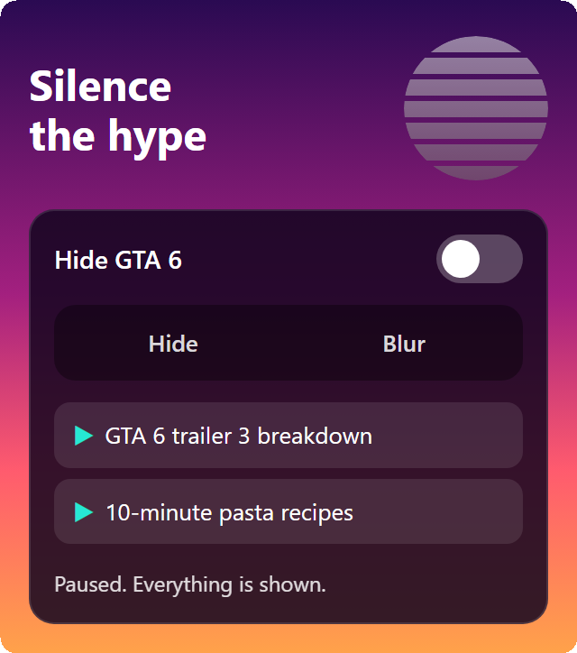
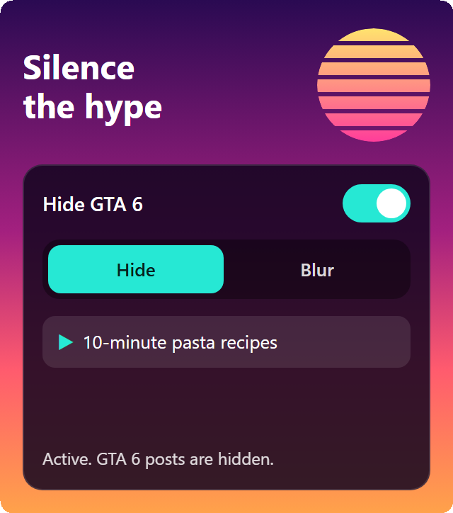
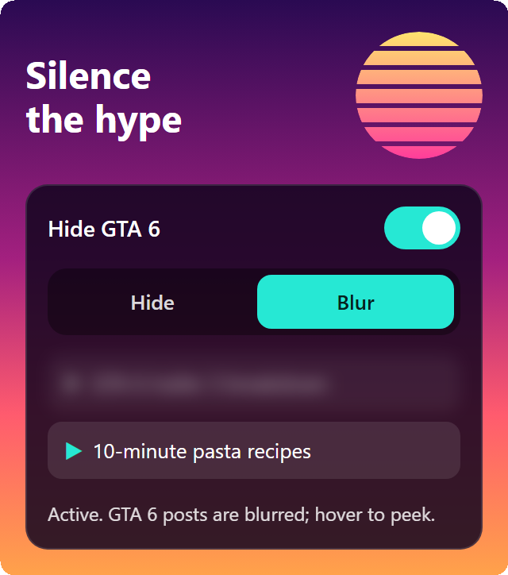
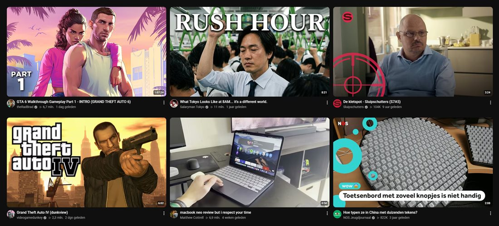
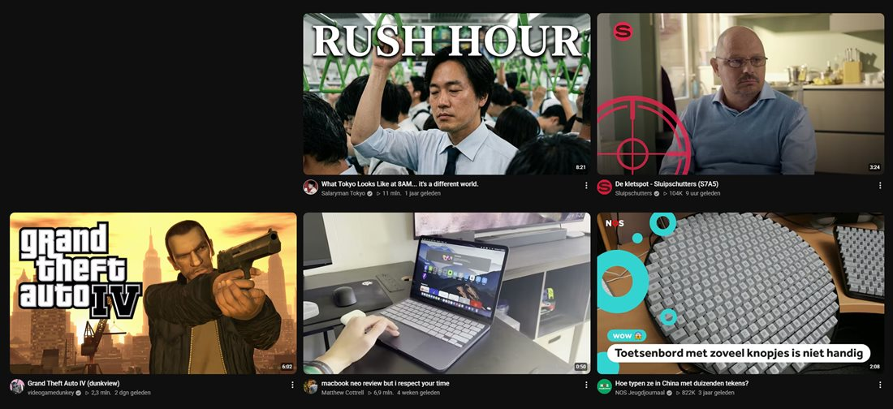
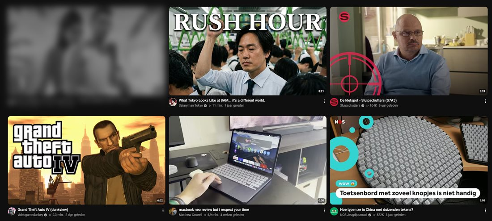

# Grand Theft Silence

Browser extension (Chrome / Edge / Brave, Manifest V3) that hides or blurs
anything mentioning GTA 6, GTA6, GTA-6, GTA VI, GTA six, or Grand Theft Auto 6/VI/six.

<table align="center">
  <tr>
    <td align="center"> <b>Off</b></td>
    <td align="center"> <b>Hide</b></td>
    <td align="center"> <b>Blur</b></td>
  </tr>
</table>

## Install (unpacked)
1. Open `chrome://extensions` (or `edge://extensions`).
2. Enable **Developer mode**.
3. Click **Load unpacked** and select this folder.
4. Pin the extension from the puzzle-piece menu to keep the popup one click away.

## Use
Click the extension icon to:
- turn the filter on or off
- choose **Hide** (removes matches) or **Blur** (blurs matches, hover to peek)

## Examples
YouTube's home feed with the filter off, set to Hide, and set to Blur. The GTA 6
video is the first thumbnail. The Grand Theft Auto IV video and the rest are left alone.

**Off**

**Hide**

**Blur**

## Customise
- Edit `PATTERN` in `content.js` to change what is matched.
- Edit `CONTAINERS` in `content.js` to control how much is hidden around a match.
